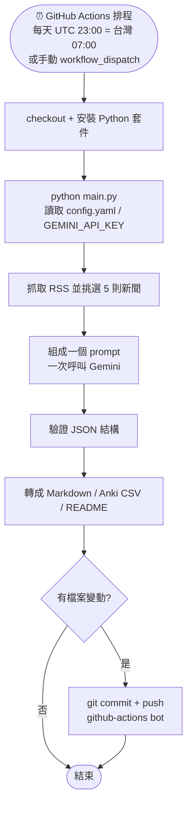
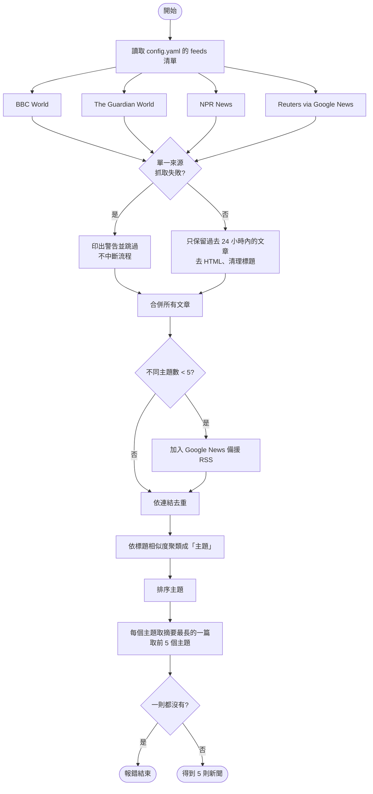
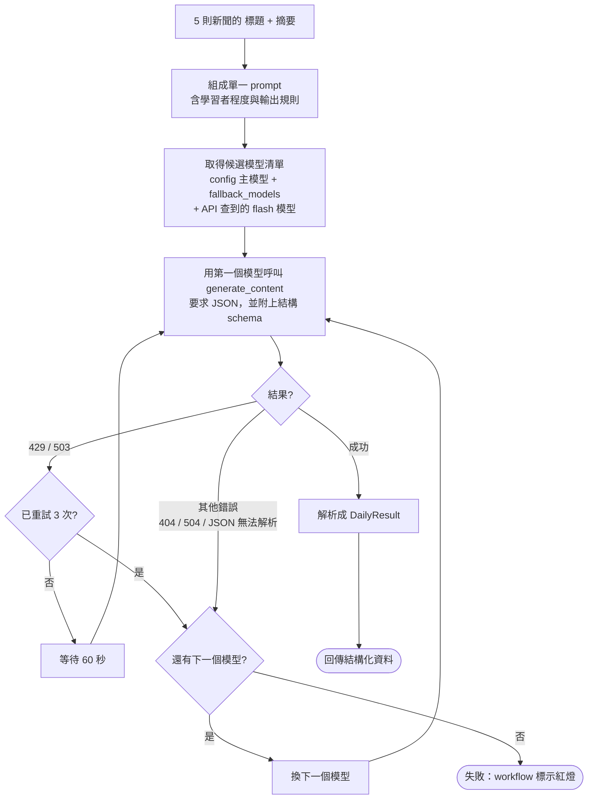
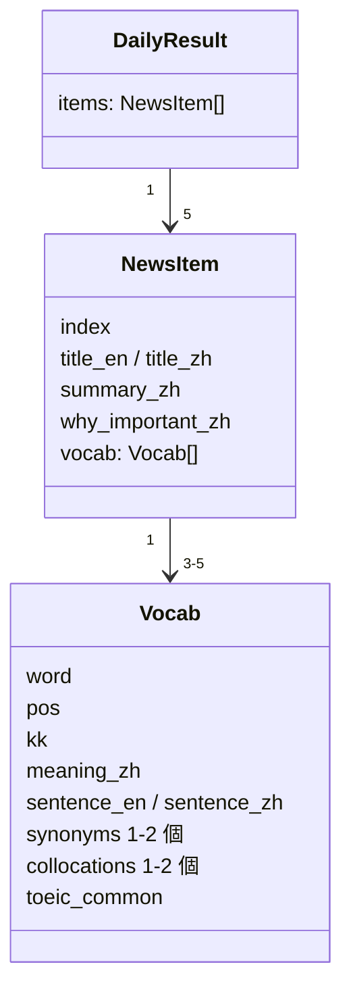
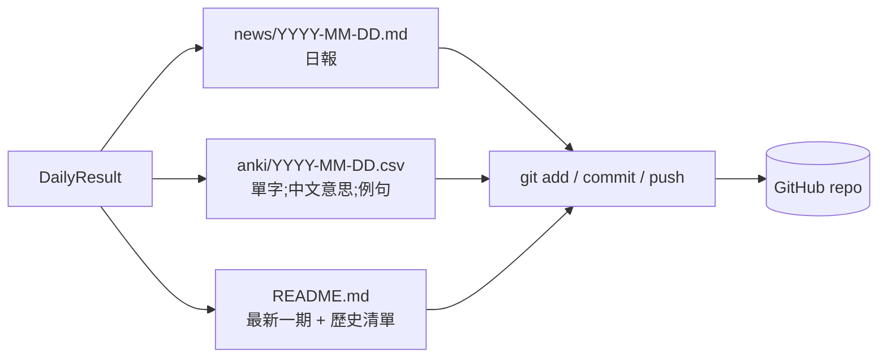

# 運作原理：從 RSS 到單字卡

本文說明每天自動抓新聞、整理單字的完整流程。對應程式：[`main.py`](main.py)、[`config.yaml`](config.yaml)、[`.github/workflows/daily-news.yml`](.github/workflows/daily-news.yml)。

## 1. 整體流程

## 2. 抓新聞與挑選 5 則

### 如何判斷「重要」與「避免重複」

| 步驟 | 作法 |
| --- | --- |
| 相似標題 | 標題轉小寫、去掉停用字後取關鍵詞集合；兩篇的重疊比例 ≥ 0.5 視為同一主題 |
| 重要程度 | 報導該主題的**不同媒體數**越多越重要 |
| 同分排序 | 取該主題在各來源 RSS 中的**最前面名次**（媒體通常把重要新聞排前面） |
| 代表文章 | 同一主題中挑摘要最長的，讓 Gemini 有較多內容可用 |

## 3. 呼叫 Gemini（一次處理 5 則）

要點：

- **一次請求**處理 5 則，節省免費額度。
- 每次呼叫有 120 秒逾時，避免卡死。
- Gemini 必須回傳固定 JSON 結構，Markdown 由程式自己產生，格式才穩定。

### Gemini 回傳的資料結構

## 4. 輸出與發佈

- 檔名日期使用台灣時間（`timezone_offset: 8`）。
- Anki CSV 會依單字去重；匯入 Anki 時分隔符號選「分號」。
- 同一天重跑會覆蓋當天檔案，不會產生重複。

## 5. 錯誤處理一覽

| 狀況 | 處理 |
| --- | --- |
| 某個 RSS 失敗或無內容 | 跳過該來源，其他照常 |
| 新聞不足 5 則 | 改用 Google News RSS 補足 |
| 所有來源都沒新聞 | 報錯，workflow 失敗 |
| Gemini 429 / 503 | 等 60 秒重試，最多 3 次 |
| 主模型仍失敗、模型下架或 JSON 無法解析 | 自動換下一個候選模型 |
| 全部模型都失敗 | 不寫入檔案，workflow 失敗，可在 Actions 頁面看日誌 |
| 沒有檔案變動 | 不 commit |

## 6. 常用調整

| 想做的事 | 修改位置 |
| --- | --- |
| 新增 / 移除新聞來源 | `config.yaml` → `feeds` |
| 改新聞數量、時間範圍 | `config.yaml` → `news_count`、`lookback_hours` |
| 換 Gemini 模型 | `config.yaml` → `gemini.model` / `fallback_models` |
| 改執行時間 | `.github/workflows/daily-news.yml` → `cron`（UTC，台灣時間減 8 小時） |
| 暫停排程 | GitHub → Actions → Daily News → ⋯ → Disable workflow |
